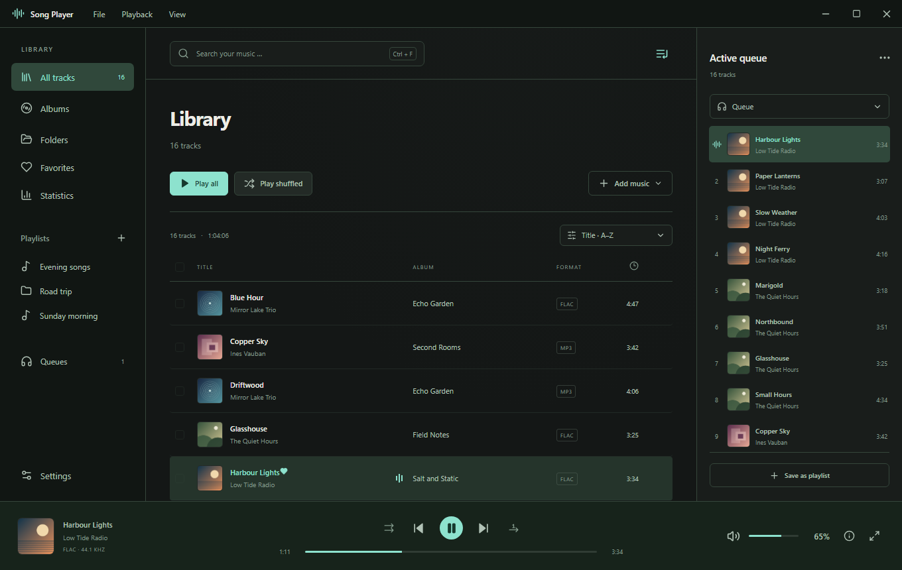
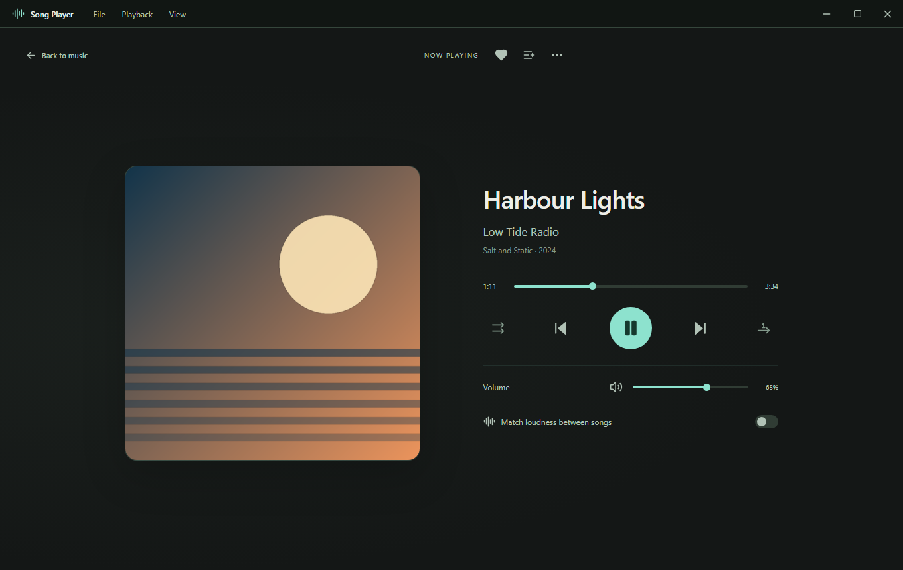
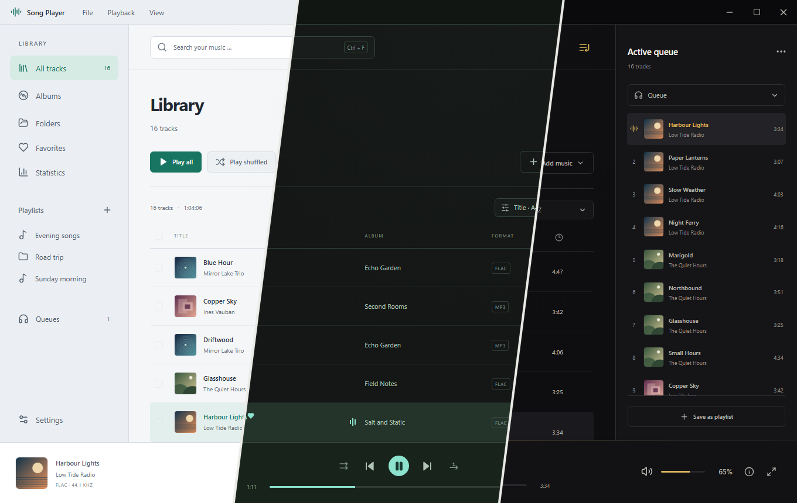

# Song Player

Local audio player for Windows, version **0.5.0**. Tauri 2 and React provide the
interface; Rust manages playback, library, playlists and queues. Native audio
output is handled by libmpv. Audio files stay where they are stored.



## Features

- **Library**: add music folders, browse by album or folder, search and sort;
  folders are rescanned in the background when files change.
- **Broad format support** through libmpv, including FLAC, ALAC, MP3, AAC/M4A,
  Opus, Vorbis, WAV/AIFF, WMA, WavPack and APE.
- **Several queues**, each with its own position, shuffle and repeat mode;
  reorder entries, play next, and pause by sleep timer.
- **Playlists and favorites**: pin playlists to the sidebar, give them an icon
  or image, import M3U/M3U8 and export M3U8.
- **Now Playing view** with cover and controls, plus Windows media controls,
  media keys and a tray menu.
- **Loudness matching and equalizer**: ReplayGain analysis per track, album or
  folder, and a five-band equalizer with presets.
- **Quick search** with typo tolerance for tracks and actions, optionally from
  anywhere in Windows through a global shortcut.
- **Listening statistics** by month, year and all time. The history stays
  local, can be exported or deleted, and recording can be turned off.
- **Audio editor**: select a part on the waveform, preview it and export it as
  a new FLAC or WAV file. The source file is never overwritten.
- **Themes and languages**: Light, Dark, Gold and custom themes, German and
  English, custom keyboard shortcuts, and settings backup with import preview.

## Screenshots

| Now Playing | Themes: Light, Dark and Gold |
| --- | --- |
|  |  |

The screenshots show demo data.

## Running on Windows

Requirements for a fresh checkout:

- Node.js 22.12 or newer and npm.
- Rust stable with the target `x86_64-pc-windows-msvc`.
- Visual Studio Build Tools with **Desktop development with C++**, MSVC and a
  Windows SDK.
- Microsoft Edge WebView2 Runtime for the Tauri interface.

The [Tauri prerequisites](https://v2.tauri.app/start/prerequisites/#windows)
describe how to install the Windows tools. The Node requirement matches the
[Vite](https://vite.dev/guide/) version used here.

In the project directory, in PowerShell:

```powershell
npm install
powershell -File .\scripts\setup-mpv.ps1
powershell -File .\scripts\setup-ffmpeg.ps1
npm exec -- tauri dev
```

In a project that is already set up, `npm run desktop` is enough. The command
uses an existing local toolchain automatically. `npm run desktop:build` creates
the package for the current platform.

The first Rust build downloads its Cargo dependencies. Tauri starts the Vite
development server automatically. `npm run dev` alone shows the interface in
the browser; real audio playback and file access need the desktop window.

If a project-local Rust/MSVC toolchain was set up under `.tools`, it can be
used through the helper:

```powershell
powershell -File .\scripts\desktop.ps1 dev
```

Or for several commands in the same PowerShell session:

```powershell
. .\scripts\toolchain.ps1
npm exec -- tauri dev
```

The helpers detect existing local tools; they do not install a toolchain.
`.tools` is not distributed with the source code. Without local tools they use
the regularly installed toolchain.

## libmpv runtime

`scripts/setup-mpv.ps1` downloads the pinned Windows x64 build
`mpv-dev-x86_64-20261111-git-bcde6b93cc.7z` from shinchiro, verifies archive and
DLL against recorded SHA256 values and places `libmpv-2.dll` under
`src-tauri/resources/mpv/`. This provider is named on the
[mpv installation page](https://mpv.io/installation/). The script needs Windows
`tar.exe`; a libmpv SDK or a system-wide mpv installation is not required for
compiling.

The DLL is packaged as an app resource. Build provenance and checksums are in
`src-tauri/resources/mpv/build-manifest.json`; license notices in
[THIRD_PARTY_NOTICES.md](THIRD_PARTY_NOTICES.md).

A compatible runtime of your own can be specified through
`SONG_PLAYER_MPV_PATH`, either as a library file or as a folder. The bundled
runtime takes precedence. On macOS/Linux a matching `libmpv.2.dylib` or
`libmpv.so.2` and its native dependencies have to be provided separately.

Analysis, waveform, editor preview and export additionally use a separately
bundled FFmpeg program. `scripts/setup-ffmpeg.ps1` verifies archive and program
against fixed SHA256 values and installs the Windows x64 runtime under
`src-tauri/resources/ffmpeg/`. Other platforms need a matching native FFmpeg
runtime; packaging has not been verified there yet.

## Testing and building the Windows package

```powershell
. .\scripts\toolchain.ps1
npm run build
cargo test
cargo check -p song-player
npm run test:ui
npm run test:locales
```

The native playback tests are ignored by default because they need a libmpv
runtime. Once it is set up, they can be run explicitly with null audio output,
without sound on the speakers:

```powershell
cargo test -p player-infrastructure native_engine -- --ignored --nocapture
cargo test -p player-application --test native_playback -- --ignored --nocapture
```

With both runtimes set up,
`cargo test --workspace --offline -- --include-ignored` additionally runs all
FFmpeg analysis, metadata and export tests.

A Windows x64 NSIS installer is built with:

```powershell
powershell -File .\scripts\desktop.ps1 build --bundles nsis
```

With a regularly installed toolchain the equivalent command is
`npm exec -- tauri build --bundles nsis`. Tauri prints the path of the finished
installer at the end of the build; it is normally under
`target/release/bundle/nsis/`. The first build may download the NSIS build
tools.

## Separate test profile

By default Song Player uses the platform-specific Tauri directories for app
data and cover cache. The database is named `song-player.sqlite`. For a test with
separate settings and library, close running Song Player windows first:

```powershell
$env:SONG_PLAYER_DATA_DIR = Join-Path (Get-Location) '.tmp\test-profile'
powershell -File .\scripts\desktop.ps1 dev
```

The test profile creates the database and `covers/` in the given folder. The
variable applies to the current shell and its child processes. To return to the
normal profile:

```powershell
Remove-Item Env:SONG_PLAYER_DATA_DIR
```

## Status and limits

Windows is the first target platform. macOS and Linux are considered in the
structure but have not been verified at runtime yet; packaging for them needs
matching native runtimes. System media controls are currently connected on
Windows only.

Crossfade, general tag editing, A–B loops and weighted shuffle strategies are
not implemented yet. Bit-perfect audio output is not guaranteed. Format
support, gapless playback and device behaviour also depend on the specific
engine build and audio device.

Settings files contain neither music files nor playlist images, favorites or
listening history; the history has its own export. Automatically relocating
moved tracks uses only unambiguous content checksums of missing files, no
guessed metadata.

Version 0.5.0 renamed the internal identifiers left over from earlier project
names. The app data now lives under `io.github.norfila.songplayer`, and theme
and settings exports use the formats `song-player-theme` and
`song-player-settings`. Builds before 0.5.0 are not upgraded in place, and
their data folder and export files are not picked up automatically.

## License

Song Player is licensed under the GNU General Public License, version 3 or
later; see [LICENSE](LICENSE). The bundled libmpv and FFmpeg runtimes and other
third-party components keep their own licenses, listed in
[THIRD_PARTY_NOTICES.md](THIRD_PARTY_NOTICES.md).
