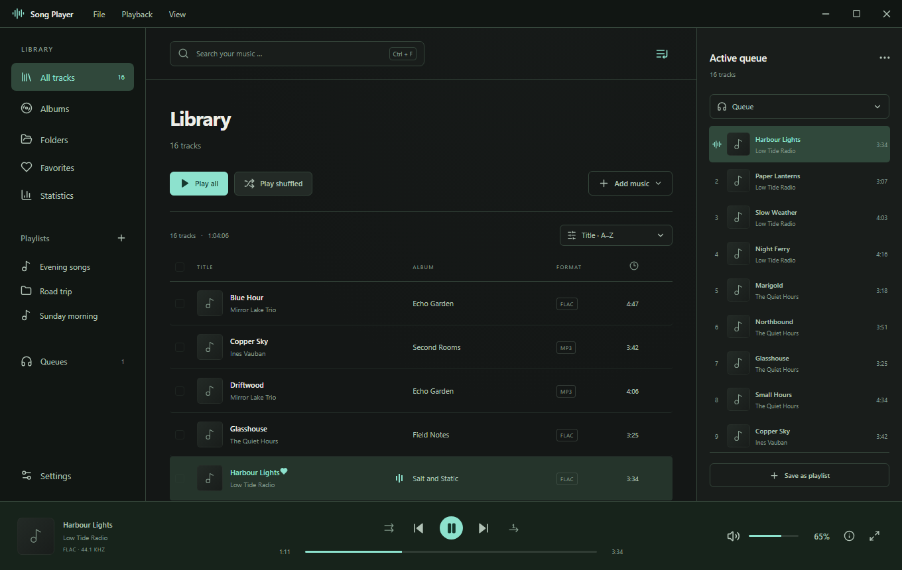

# Song Player

Local audio player for Windows, version **0.4.3**. Tauri 2 and React provide the
interface; Rust manages playback, library, playlists and queues. Native audio
output is handled by libmpv. Audio files stay where they are stored.



## Features

- Open files and folders, add folders to the library and drop files onto the
  queue.
- Play/pause, next/previous track, seeking, volume and mute. Over the volume
  slider, icon or percentage the mouse wheel changes the volume; this applies to
  the bottom player and to the large Now Playing view.
- Integrated title bar with File/Playback/View menus and window buttons.
- Large Now Playing view with cover and audio controls. "Back" restarts the
  current track after more than three seconds; there is no separate stop/reset
  button.
- Edit the queue, reorder entries, play next or append; the same track can be
  added more than once.
- Repeat a single track or the whole queue from a selection menu. Turn shuffle
  on and off for the active queue; turning it off restores the previous play
  order.
- Sort by title, artist, album, filename, year, duration or import time; the
  selection states the direction explicitly, for example "Title · A–Z".
- Search the library and browse it by album or folder; music folders are
  rescanned in the background when files change.
- Remove folders from the library directly in the folder view (icon on the
  folder card or button in the opened folder) or under Settings → Library. The
  files are kept. Removed subfolders of a music folder stay out on later rescans
  until they are added again; individually added files stay in the library.
- Create empty playlists or explicitly save a queue as a playlist. A searchable
  dialog edits membership in several playlists at once. Pinned playlists appear
  in the sidebar; each playlist can have its own icon or an imported image.
  M3U/M3U8 import and M3U8 export.
- Mark tracks as favorites and find them in their own view.
- Several queues, each with its own position and play order; one plays at a time.
- Show metadata, embedded covers and cover files in the music folder.
- Match loudness between tracks: analyse ReplayGain values and store them
  locally, per track or jointly for albums and folders. Optionally write
  compatible tags into supported files. Dynamic balancing remains a separate
  advanced setting. Five-band equalizer with preamp and presets.
- Sleep timer in the menu of the active queue and in the Now Playing view: pause
  after a time, after the current track or at the end of the queue.
- Listening statistics for month, year and all time with compact date fields,
  listing only years that have listening history. Recording, counting
  threshold, export and deletion are under Settings → Statistics; the statistics
  page links there directly.
- Quick search with typo tolerance, keyboard navigation and locally learned
  ranking. `>` searches actions. A separate optional Windows system shortcut
  opens the search outside the app window too, as long as the app is running.
- Simple audio editor with waveform, selection, preview and undo: keep or
  remove the selection and export it as a new FLAC or WAV file.
- German and English, switchable during playback.
- Windows system media controls, media keys, native menus and tray menu.
- Optionally close to the system tray and keep playing.
- Custom keyboard shortcuts, including for the Now Playing view; with conflict
  checking and reset to defaults.
- Resize the library navigation and the active queue with the mouse. Sizes are
  saved; double-clicking the divider resets them.
- Settings with categories and search; results open and highlight the matching
  setting. The active queue can be shown and hidden there as well; narrow
  settings areas use horizontally scrollable categories.
- Light, Dark and Gold themes; custom themes with colors, font, text size,
  spacing, corner radius and shadows. Changes can be tried out before saving,
  then applied or discarded.
- Import and export themes separately as JSON. Back up settings by category,
  compare before importing and undo the last import even after a restart.
- Notice about Windows default apps that opens the Song Player page directly,
  with "Remind me later" and "Don't remind me". The file associations
  themselves are chosen in Windows Settings.
- Files opened from Explorer are handed to the running app instance; file
  associations are set up by the installer. Externally opened files can open the
  Now Playing view directly; a temporary notice offers to add the containing
  folder to the library. Both are configurable.
- Library, sessions and settings are restored from SQLite. After a normal app
  start, music only begins on a playback action.
- Quiet start: the window appears once the first view is ready with language
  and theme. With a saved current track the app opens Now Playing directly.

The entries formerly called "listening sessions" are named "Queues" in the
interface. They also store the current position and the shuffle/repeat modes. A
playlist, in contrast, stores a list of tracks to play later. Pause keeps the
position; "Back" restarts the track after three seconds. The large view opens
from the cover, the title or the expand icon in the player. Loudness matching
can be turned on there, in the Playback menu and in the audio settings. Shuffle
and repeat mode use the same settings in the bottom player, the large view and
the active queue. The repeat menu offers "Play next track", "Repeat queue" and
"Repeat track" with icons and a radio selection. The play order can be changed
from the three-dot menu of the queue. Short playback actions do not trigger a
global loading indicator; other operations show it only after 300 ms.

"Close to system tray" is under Settings → General. File → Quit or the tray
menu exits Song Player completely. Keyboard shortcuts are changed under
Settings → Keyboard shortcuts: click the binding and press the new combination.
Escape cancels recording, Backspace removes a binding. The default for the
large view is `Ctrl + Shift + P`; shortcuts apply while the app is focused and
not during text input. `Ctrl + F` opens the quick search; inside the settings,
the settings search stays directly reachable. The global search shortcut is
enabled separately in the settings and requires Ctrl or Alt; global conflicts
are reported. A notice about missing default associations can be hidden for the
current app start with "Remind me later". "Don't remind me" stores the choice
permanently. Opening the Windows settings directly remains available under
Settings → General. There is no additional reminder switch in the settings.

The mouse wheel changes the volume over the volume area by two percentage
points per regular notch; fine touchpad movements are accumulated. The range
stays between 0 and 100 percent, and an existing mute is kept.

Settings → Appearance offers Light, Dark and Gold. A built-in theme can be
duplicated and adjusted as a custom theme. The preview applies to the whole
window; "Apply" saves it, "Discard" restores the saved theme. A theme export
contains only the theme (`sonora-theme`, version 1), no folders, shortcuts or
audio settings.

Under Settings → Data & Backup, General, Appearance, Audio, Keyboard shortcuts
and window layout can be exported individually. Output device and library
folders are optional because they depend on the computer. When importing a
settings file (`sonora-settings`, version 1), only the selected categories are
applied; the preview shows the values before and after. Folders are added, the
music files themselves stay where they are. Library tracks, queues and
playlists are not part of this settings file. "Undo last import" restores the
previous settings and folder assignments and remains available after a restart.

By default the statistics count a track after 50 percent or four minutes,
whichever is reached first. Pauses and skipped time do not count. Each play
counts at most once; repeats can count again. The threshold can be applied
retroactively to the stored history. The time selection assigns a play by its
start time. History and search learning stay local and can be reset
separately; statistics can be turned off. Listening times from older versions
cannot be reconstructed afterwards.

ReplayGain changes a whole track evenly and preserves its dynamics. The
album/folder option analyses a group together, so deliberately quiet tracks in
the group stay quieter. Folder values exist only in the app; there is no
interoperable ReplayGain folder tag. Writing tags is an explicit option for
FLAC, MP3, Ogg Vorbis and M4A. Without that choice the analysis changes no
music files. Dynamic balancing also adjusts passages within a track. Equalizer,
ReplayGain and dynamic balancing each use their own filter and remove no
foreign filters.

The editor does not overwrite the source file and for now exports only FLAC or
WAV. Lossy sources do not regain lost quality this way. Additional disk space
is needed. Long analysis and export tasks run in the background and can be
cancelled.

libmpv provides the broad format support, including WAV/AIFF, FLAC, ALAC, MP3,
AAC/M4A, Vorbis, Opus, WMA, WavPack and APE. Not every format and variant has
been checked with its own test file yet. Metadata is read by Lofty; for a
format unknown to it, the file stays playable with the filename as its title.
Gapless uses the libmpv mode `weak`; gapless transitions across arbitrary
format or device changes are not guaranteed.

## Running on Windows

Requirements for a fresh checkout:

- Node.js 22.12 or newer and npm.
- Rust stable with the target `x86_64-pc-windows-msvc`.
- Visual Studio Build Tools with **Desktop development with C++**, MSVC and a
  Windows SDK.
- Microsoft Edge WebView2 Runtime for the Tauri interface.

The [Tauri prerequisites](https://v2.tauri.app/start/prerequisites/#windows)
describe how to install the Windows tools. The Node requirement matches the
[Vite](https://vite.dev/guide/) version used here.

In the project directory, in PowerShell:

```powershell
npm install
powershell -File .\scripts\setup-mpv.ps1
powershell -File .\scripts\setup-ffmpeg.ps1
npm exec -- tauri dev
```

In a project that is already set up, `npm run desktop` is enough. The command
uses an existing local toolchain automatically. `npm run desktop:build` creates
the package for the current platform.

The first Rust build downloads its Cargo dependencies. Tauri starts the Vite
development server automatically. `npm run dev` alone shows the interface in
the browser; real audio playback and file access need the desktop window.

If a project-local Rust/MSVC toolchain was set up under `.tools`, it can be
used through the helper:

```powershell
powershell -File .\scripts\desktop.ps1 dev
```

Or for several commands in the same PowerShell session:

```powershell
. .\scripts\toolchain.ps1
npm exec -- tauri dev
```

The helpers detect existing local tools; they do not install a toolchain.
`.tools` is not distributed with the source code. Without local tools they use
the regularly installed toolchain.

## libmpv runtime

`scripts/setup-mpv.ps1` downloads the pinned Windows x64 build
`mpv-dev-x86_64-20261111-git-bcde6b93cc.7z` from shinchiro, verifies archive and
DLL against recorded SHA256 values and places `libmpv-2.dll` under
`src-tauri/resources/mpv/`. This provider is named on the
[mpv installation page](https://mpv.io/installation/). The script needs Windows
`tar.exe`; a libmpv SDK or a system-wide mpv installation is not required for
compiling.

The DLL is packaged as an app resource. Build provenance and checksums are in
`src-tauri/resources/mpv/build-manifest.json`; license notices in
[THIRD_PARTY_NOTICES.md](THIRD_PARTY_NOTICES.md).

A compatible runtime of your own can be specified through
`AUDIOPLAYER_MPV_PATH`, either as a library file or as a folder. The bundled
runtime takes precedence. On macOS/Linux a matching `libmpv.2.dylib` or
`libmpv.so.2` and its native dependencies have to be provided separately.

Analysis, waveform, editor preview and export additionally use a separately
bundled FFmpeg program. `scripts/setup-ffmpeg.ps1` verifies archive and program
against fixed SHA256 values and installs the Windows x64 runtime under
`src-tauri/resources/ffmpeg/`. Other platforms need a matching native FFmpeg
runtime; packaging has not been verified there yet.

## Testing and building the Windows package

```powershell
. .\scripts\toolchain.ps1
npm run build
cargo test
cargo check -p sonora
npm run test:ui
npm run test:locales
```

The native playback tests are ignored by default because they need a libmpv
runtime. Once it is set up, they can be run explicitly with null audio output,
without sound on the speakers:

```powershell
cargo test -p player-infrastructure native_engine -- --ignored --nocapture
cargo test -p player-application --test native_playback -- --ignored --nocapture
```

With both runtimes set up,
`cargo test --workspace --offline -- --include-ignored` additionally runs all
FFmpeg analysis, metadata and export tests.

A Windows x64 NSIS installer is built with:

```powershell
powershell -File .\scripts\desktop.ps1 build --bundles nsis
```

With a regularly installed toolchain the equivalent command is
`npm exec -- tauri build --bundles nsis`. Tauri prints the path of the finished
installer at the end of the build; it is normally under
`target/release/bundle/nsis/`. The first build may download the NSIS build
tools.

## Separate test profile

By default Song Player uses the platform-specific Tauri directories for app
data and cover cache. The database is named `sonora.sqlite`. For a test with
separate settings and library, close running Song Player windows first:

```powershell
$env:SONORA_DATA_DIR = Join-Path (Get-Location) '.tmp\test-profile'
powershell -File .\scripts\desktop.ps1 dev
```

The test profile creates the database and `covers/` in the given folder. The
variable applies to the current shell and its child processes. To return to the
normal profile:

```powershell
Remove-Item Env:SONORA_DATA_DIR
```

## Status and limits

Windows is the first target platform. macOS and Linux are considered in the
structure but have not been verified at runtime yet; packaging for them needs
matching native runtimes. System media controls are currently connected on
Windows only.

Crossfade, general tag editing, A–B loops and weighted shuffle strategies are
not implemented yet. Bit-perfect audio output is not guaranteed. Format
support, gapless playback and device behaviour also depend on the specific
engine build and audio device.

The visible name is now Song Player. The internal identifiers
`dev.sonora.player`, `sonora.sqlite`, `Sonora.Audio`, `SONORA_DATA_DIR` and the
export formats `sonora-theme` and `sonora-settings` are kept for existing
profiles, file associations and backups. Settings files contain neither music
files nor playlist images, favorites or listening history; the history has its
own export. Automatically relocating moved tracks uses only unambiguous content
checksums of missing files, no guessed metadata.

## License

Song Player is licensed under the GNU General Public License, version 3 or
later; see [LICENSE](LICENSE). The bundled libmpv and FFmpeg runtimes and other
third-party components keep their own licenses, listed in
[THIRD_PARTY_NOTICES.md](THIRD_PARTY_NOTICES.md).
